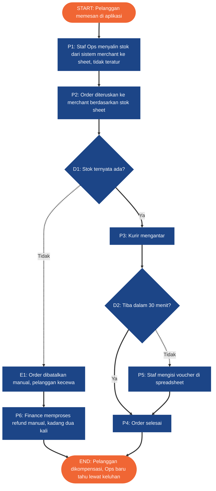
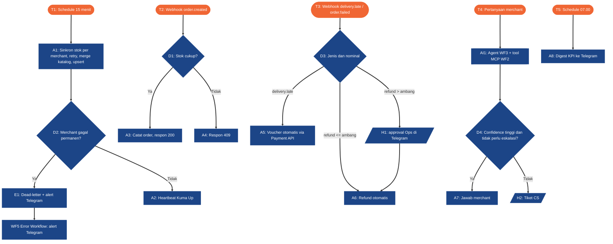

# 01 · BRD Ringkas + Process Map As-Is / To-Be · H8Mart Quick-Commerce Ops

**Nama:** Gifari

## 1. BRD Ringkas

| Item | Isi | Sumber |
| --- | --- | --- |
| Masalah bisnis (minimal 3, mencakup stok, SLA atau refund, dan reliability) | (1) **Stok tidak sinkron**: sinkron dari Merchant Stock API terlambat atau gagal diam-diam sehingga pelanggan memesan barang yang habis. (2) **SLA 30 menit terlewat** dan voucher kompensasi diberikan manual lewat spreadsheet. (3) **Refund order gagal** diproses manual oleh finance dan kadang dua kali. (4) **Merchant bertanya ke CS** dan CS menarik data manual. (5) **Tidak ada yang tahu** bila laporan harian atau sinkron stok berhenti. | README soal bagian 1 *Skenario*, poin 1-5; stok awal `core.merchant_stock` sengaja basi 6 jam (`data-contract.md` bagian 2) |
| Tujuan & ukuran keberhasilan (angka) | Order dengan stok habis ditolak 409 (target 100% pada uji fixture); sinkron stok tiap 15 menit dengan `core.merchant_stock` tetap 205 baris (0 duplikat); voucher dan refund diproses tepat sekali (0 pembayaran ganda); kegagalan sampai ke Telegram < 1 menit; 100% refund > Rp100.000 melewati approval Ops | README bagian 1 *Hasil akhir*; `data-contract.md` bagian 4 (idempotency); angka ambang: asumsi (bagian 6) |
| Stakeholder & actor | Tim Ops H8Mart (penerima digest, alert, approval refund); CS (menerima eskalasi tiket); Finance (refund); 12 merchant (M001-M012); pelanggan; sistem: Merchant Stock API, Payment API, Notification API | README bagian 1 |
| Volume & frekuensi | 12 merchant x 15 order/hari = **180 order/hari** (~5.400/bulan) pada data seed; sinkron stok 96 kali/hari (tiap 15 menit); 1 digest/hari (07.00 WIB) | `seed/02-seed-data.sql` baris 55 (12 merchant x 15 order per hari, 90 hari); skenario |
| Aturan bisnis BR1 | Order hanya diterima bila stok **semua item** cukup; bila ada item habis, tolak dengan 409. Event `order.created` ganda tidak membuat order ganda | README *Hasil akhir* poin 1; `data-contract.md` bagian 5 |
| Aturan bisnis BR2 | Voucher keterlambatan otomatis: **Rp15.000** bila telat <= 60 menit, **Rp30.000** bila > 60 menit. Refund `total_amount` **otomatis bila <= Rp100.000**, di atas itu **wajib approval Ops**. Tiap tindakan sekali per order (`Idempotency-Key`) | Node `Tentukan Kebijakan` di WF4; nominal: asumsi kebijakan (bagian 6) |
| Aturan bisnis BR3 | Asisten AI hanya menjawab dari data tool; bila confidence < 0,6 atau pertanyaan menyangkut kompensasi/refund, **eskalasi ke CS** (tiket `ops.tickets`), tidak pernah menjanjikan voucher atau refund. `merchant_id` hanya dari konteks sistem, bukan dari teks pertanyaan | Node `Lolos Guardrail?` WF3 dan system prompt agent |
| Dalam scope automasi | Sinkron stok + dead-letter, intake order + cek stok, digest harian, tool data merchant (MCP), asisten AI merchant (webhook + Telegram), voucher dan refund, Error Workflow + alert, heartbeat Kuma | README bagian 3 |
| Di luar scope (saat ini) | Keputusan refund besar (tetap manusia), pembayaran nyata (Payment API tiruan), WhatsApp dan voice note (opsional, tidak dinilai), dashboard BI, pengiriman ulang otomatis dead-letter | README bagian 3 *Eksplorasi opsional*; keputusan desain |

## 2. Process Map As-Is (proses manual hari ini)

Jeda utama: P1 (stok basi, tidak ada yang tahu bila sinkron berhenti), P5 (voucher menunggu staf), P6 (refund menunggu finance dan tanpa pencegahan ganda). Merchant yang bertanya "kenapa order saya banyak batal?" menunggu CS menarik data manual.

## 3. Process Map To-Be (rancangan automasi)

## 4. Tabel Translasi ke Automation Flow

| Kode | Langkah manual (as-is) | Elemen automation flow (n8n) | Nama node / workflow | Alasan (bukan sekadar mengulang nama node) |
| --- | --- | --- | --- | --- |
| P1 | Salin stok manual dari merchant | Schedule + Loop Over Items (1 merchant per iterasi) + HTTP Request + Retry On Fail + Merge + upsert | WF1 `Jadwal Sinkron 15 Menit`, `Loop Per Merchant`, `Ambil Stok Merchant API`, `Gabungkan Katalog`, `Upsert Stok` | Stok harus segar tiap 15 menit; Loop satu merchant per iterasi membuat Retry On Fail berlaku per merchant (bila banyak item masuk sekaligus, retry memutuskan dari item pertama saja), Retry mengatasi gagal sementara (M004), `continueErrorOutput` mengisolasi merchant gagal permanen (M009) supaya yang lain tetap jalan; upsert menjaga 205 baris tanpa duplikat |
| D1 | Cek stok dari sheet | Webhook + Code + If | WF1 `Webhook order.created`, `Evaluasi Stok`, `Stok Cukup?` | Keputusan deterministik dan harus cepat dalam satu request; AI tidak diperlukan |
| E1 | Batalkan order manual | Respon 409 + dead-letter | WF1 `Respon 409 Stok Habis`, `Catat Dead-Letter` | Penolakan di depan mencegah order yang tak bisa dipenuhi; kegagalan tak pulih disimpan supaya bisa ditelusuri |
| P5 | Isi voucher di spreadsheet | Switch + Set kebijakan + Payment API ber-`Idempotency-Key` | WF4 `Jenis Event?`, `Tentukan Kebijakan`, `Panggil Payment Voucher` | Aturan nominal tetap dan jelas, jadi rule-based; idempotency key `VOUCHER-<order_id>` mencegah voucher ganda saat event terkirim ulang |
| P6 / H1 | Finance memproses refund | If ambang + Telegram Send and Wait + Payment API | WF4 `Perlu Approval?`, `Minta Approval Telegram`, `Panggil Payment Refund` | Refund kecil otomatis; nominal besar punya risiko uang sehingga manusia tetap memutuskan; key `REFUND-<order_id>` mencegah dobel |
| AI1 | CS menarik data lalu menjawab merchant | AI Agent + MCP Client Tool + Structured Output Parser | WF3 `Asisten Merchant (AI Agent)`, WF2 `MCP Server Trigger` | Pertanyaan berbentuk bahasa bebas yang perlu merangkum data; tool read-only (`mcp_reader`) membatasi akses data |
| D4 / H2 | CS menilai apakah jawaban cukup | If guardrail + INSERT tiket | WF3 `Lolos Guardrail?`, `Buat Tiket CS` | Jawaban AI tidak boleh dikirim bila ragu; eskalasi ke manusia lebih aman daripada jawaban karangan |
| A8 | Staf menyusun laporan Ops | Schedule 07.00 + SQL + Telegram | WF1 `Jadwal Digest 07.00 WIB`, `Hitung KPI Harian`, `Kirim Digest Telegram` | KPI dihitung dengan SQL (angka harus tepat), bukan AI |
| - | Tidak ada yang tahu bila gagal | Error Trigger + alert + heartbeat | WF5 `Error Trigger`, `Kirim Alert Telegram`, `Heartbeat Kuma Down` | Satu Error Workflow pusat untuk WF1-WF4 menjamin tiap kegagalan sampai ke Ops dengan business key; Kuma mendeteksi sinkron yang berhenti total |

## 5. Langkah yang Sengaja Tidak Diautomasi

| Langkah | Kenapa tetap manusia | Bentuknya di workflow |
| --- | --- | --- |
| Persetujuan refund di atas Rp100.000 | Menyangkut uang keluar; kesalahan sulit ditarik kembali | WF4 `Minta Approval Telegram` (Send and Wait, tombol Approve/Decline); penolakan dicatat di `ops.refund_actions` |
| Menjawab pertanyaan kompensasi atau pertanyaan yang datanya tidak cukup | AI dilarang berjanji atau memutuskan kompensasi; jawaban ragu berisiko menyesatkan merchant | WF3 `Buat Tiket CS` di `ops.tickets`, balasan eskalasi ke merchant |
| Replay dead-letter | Penyebab kegagalan perlu dinilai manusia dulu | Baris `ops.dead_letter` berstatus `open`, ditinjau Ops |

## 6. Asumsi & pertanyaan terbuka

- Ambang refund otomatis Rp100.000 dan nominal voucher Rp15.000 / Rp30.000 (batas 60 menit) adalah **asumsi kebijakan** (belum ada angka dari H8Mart); konstanta ada di node `Tentukan Kebijakan` sehingga mudah diganti.
- Target "alert < 1 menit" adalah asumsi; Error Workflow berjalan segera setelah eksekusi gagal.
- `new_stockouts` di `ops.sync_runs` dihitung sebagai jumlah baris qty=0 pada batch sinkron itu (pendekatan), bukan transisi tepat dari >0 ke 0.
- Pertanyaan terbuka: siapa penerima alert di luar jam kerja; apakah Payment API asli punya rate limit.
