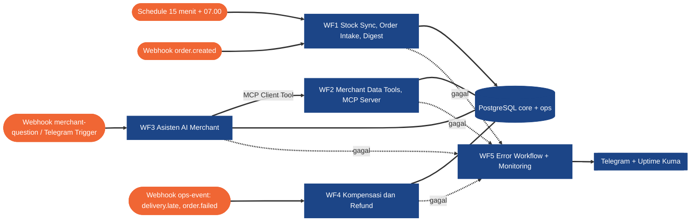

# 02 · Desain Solusi + Solution Fit + ROI · H8Mart Quick-Commerce Ops

**Nama:** Gifari
**Workflow yang dibangun:** WF1 Stock Sync, Order Intake & Digest, WF2 Merchant Data Tools, WF3 Asisten AI Merchant, WF4 Kompensasi & Refund, WF5 Reliability & Monitoring

## 1. Arsitektur 5 Workflow

## 2. Keputusan Pendekatan per Titik Keputusan (rule-based vs AI-driven)

| Kode | Pertanyaan yang diputuskan | Jenis data | Pendekatan (rule-based / AI / manusia) | Alasan |
| --- | --- | --- | --- | --- |
| D1 | Apakah stok cukup untuk order ini? | Terstruktur (qty per merchant dan produk) | **Rule-based** (Code + If: semua item `qty` stok >= `qty` order) | Jawaban benar/salah yang bisa dihitung; harus instan dan 100% konsisten; AI menambah latensi, biaya, dan risiko salah tanpa manfaat |
| D2 | Apakah cancel rate atau SLA hari ini melewati ambang? | Terstruktur (KPI dari SQL) | **Rule-based** (SQL di `Hitung KPI Harian`; ambang durasi sinkron 60.000 ms di `Terlalu Lambat?`) | Angka KPI harus tepat dan bisa diaudit dengan SQL independen; ambang tetap dan eksplisit |
| D3 | Berapa voucher atau apakah refund butuh approval? | Terstruktur (menit telat, `total_amount`) | **Rule-based + manusia**: voucher Rp15.000 (<= 60 menit) atau Rp30.000 (> 60 menit); refund <= Rp100.000 otomatis, di atasnya **approval Ops** | Menyangkut uang: aturan harus bisa dijelaskan ke finance; nominal besar butuh keputusan manusia |
| D4 | Mengapa order merchant banyak batal? (pertanyaan merchant) | Semi-terstruktur: bahasa bebas + data KPI, alasan batal, catatan pelanggan | **AI-driven** (agent `gpt-6-luna` memanggil tool MCP read-only) | Pertanyaan tidak terbatas pada pola tetap dan jawabannya harus merangkum beberapa data; AI cocok, tetapi hanya dari data tool |
| D5 | Apakah jawaban AI layak dikirim ke merchant (guardrail)? | Output terstruktur (`confidence`, `perlu_eskalasi`) | **Rule-based atas output AI** (`confidence >= 0,6` dan `perlu_eskalasi = false`), selebihnya **manusia** (tiket CS) | Keputusan akhir tidak diserahkan ke AI yang menilai dirinya sendiri; ambang jelas; fallback bila agent gagal |

Penyederhanaan yang diketahui: `new_stockouts` di `ops.sync_runs` dihitung dari jumlah baris qty=0 pada batch sinkron, bukan transisi tepat dari >0 ke 0.

## 3. Estimasi ROI

Dasar volume: seed = 12 merchant x 15 order/hari = **180 order/hari = ~5.400/bulan** (30 hari). Tarif dan waktu manual adalah **asumsi** (belum ada data H8Mart). Kurs asumsi: **Rp16.500 per US$1** (belum diverifikasi, cek kurs BI pada hari submit).

| Komponen | Rumus / asumsi | Angka |
| --- | --- | --- |
| Waktu manual per hari untuk menyusun laporan Ops | Asumsi 30 menit/hari x 30 hari | **15 jam/bulan** |
| Waktu CS per pertanyaan merchant (menarik data manual) | Asumsi 5 menit/pertanyaan; 12 merchant x 2 pertanyaan/hari x 30 hari = 720 pertanyaan | **60 jam/bulan** |
| Waktu finance/Ops per refund atau voucher manual | Asumsi 6 menit/kasus | 6 menit/kasus |
| Jumlah kasus per bulan (dasar dari data seed atau asumsi eksplisit) | Asumsi 3% dari 5.400 order = 162 kasus voucher + refund (angka sebenarnya: `SELECT count(*) FILTER (WHERE status IN ('cancelled','failed'))` pada `core.orders`; cocokkan sebelum submit) | **162 kasus/bulan = 16,2 jam** |
| Biaya tenaga per jam (asumsi) | Asumsi Rp50.000/jam | Rp50.000 |
| Penghematan per bulan | Laporan 15 jam x 90% = 13,5 jam; CS 60 jam x 70% (sisanya tereskalasi) = 42 jam; refund/voucher 16,2 jam x 80% = 13 jam; total **68,5 jam x Rp50.000** | **Rp3.425.000** |
| Biaya LLM per bulan (estimasi token x harga model; sumber harga di bawah) | 720 pertanyaan x (3.000 token input + 400 token output) = 2,16 juta input + 0,288 juta output. Harga `gpt-6-luna`: US$0,10 / 1 juta input, US$0,50 / 1 juta output. (2,16 x 0,10) + (0,288 x 0,50) = US$0,216 + US$0,144 = US$0,36 | **US$0,36 = Rp5.940** (estimasi; **ganti dengan token dari Executions WF3 sendiri** bila sudah diukur) |
| Biaya platform per bulan (rujuk dokumen 03) | EC2 + IPv4 + EBS + snapshot = US$25,92 (rincian di 03) = Rp427.680, ditambah waktu admin 2 jam x Rp50.000 = Rp100.000 | **Rp527.680** |
| **Net benefit per bulan** dan **payback** | 3.425.000 - 5.940 - 527.680 = **Rp2.891.380/bulan**. Investasi awal asumsi 40 jam membangun x Rp50.000 = Rp2.000.000; payback = 2.000.000 / 2.891.380 = **0,69 bulan (~21 hari)** | **Rp2,89 juta/bulan; payback ~21 hari** |

Sumber harga LLM: ringkasan pelacak harga pihak ketiga yang mengutip OpenAI per 11 Okt 2026: https://getdeploying.com/llms/gpt-6-luna dan https://www.eesel.ai/blog/gpt-6-luna-pricing (US$0,10 input / US$0,50 output per 1 juta token). **Belum diverifikasi ke halaman resmi OpenAI**; cek sebelum submit.

Risiko ROI (minimal dua) dan skenario terburuk:

1. **Asumsi waktu manual terlalu tinggi.** Bila waktu nyata separuhnya, penghematan menjadi ~Rp1,71 juta; net tetap positif (~Rp1,18 juta/bulan).
2. **Volume pertanyaan AI rendah atau akurasi rendah** sehingga banyak eskalasi: penghematan CS turun. Skenario terburuk: AI menjawab 0% (semua eskalasi), penghematan CS = 0, penghematan tersisa 26,5 jam x Rp50.000 = Rp1.325.000; net = 1.325.000 - 5.940 - 527.680 = **~Rp791.000/bulan** (masih positif).
3. Biaya tetap platform tidak turun bila volume turun (VPS tetap berjalan); tidak berpengaruh pada tanda net benefit pada kedua skenario di atas.

## 4. Batas Automasi & Risiko

| Risiko | Dampak | Mitigasi di rancangan |
| --- | --- | --- |
| Voucher/refund terkirim dua kali (event ganda, retry) | Kerugian uang | `Idempotency-Key` (`VOUCHER-<order_id>`, `REFUND-<order_id>`) dan kolom `idempotency_key` unik di `ops.compensations` / `ops.refund_actions` |
| AI menjawab salah atau menuruti injeksi di `customer_note` | Merchant salah informasi; kebocoran data merchant lain | System prompt memperlakukan teks sebagai data, `merchant_id` hanya dari konteks sistem, output terstruktur, guardrail `confidence >= 0,6`, eskalasi ke CS; role `mcp_reader` read-only |
| Sinkron stok berhenti atau 0 baris tanpa error | Order diterima untuk stok yang tidak ada | Deteksi "Sinkron 0 Baris", heartbeat Uptime Kuma, alert perlambatan (60 detik) |
| Merchant gagal permanen (M009) menghentikan semua merchant | Stok sebagian basi | `continueErrorOutput`: merchant gagal masuk `ops.dead_letter` dan alert, merchant lain tetap diproses |
| Payment API down | Refund/voucher tertunda | Dead-letter + alert Telegram dengan business key; replay manual setelah pulih |
| Token/credential bocor | Akses tidak sah | Credential hanya di n8n; export memakai placeholder; webhook Header Auth |
