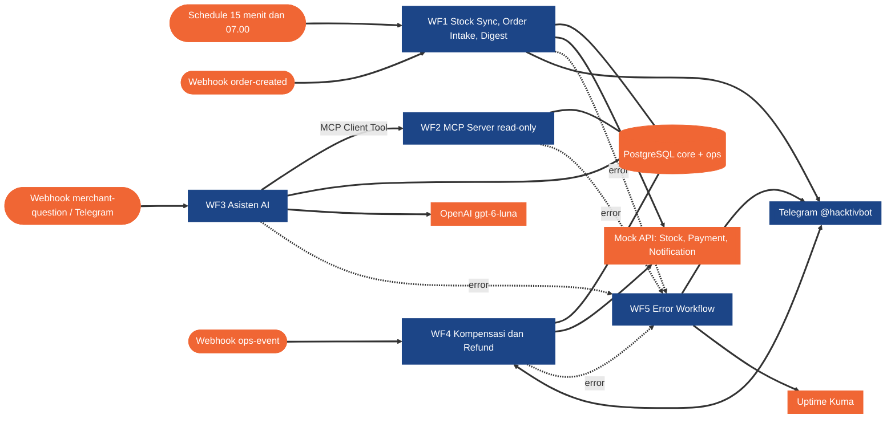

# H8Mart Quick-Commerce Ops · Gifari

## 1. Ringkasan (3 kalimat)

Lima workflow n8n self-hosted (AWS EC2 + Docker Compose + Caddy HTTPS) menutup masalah Ops H8Mart: sinkron stok tiap 15 menit dengan penolakan order saat stok habis dan digest harian (WF1), tool data read-only lewat MCP (WF2) yang dipakai asisten AI merchant (WF3), voucher otomatis dan refund dengan approval Telegram (WF4), serta Error Workflow, dead-letter, dan heartbeat (WF5). Semua keputusan berangka memakai aturan deterministik; AI hanya dipakai untuk menjawab pertanyaan merchant dengan guardrail dan eskalasi ke CS. Instance Production: https://h8mart-gifari.duckdns.org, bot Telegram `@hacktivbot`.

## 2. Arsitektur



## 3. Daftar Workflow

| Workflow | File | Trigger | Fungsi satu kalimat |
| --- | --- | --- | --- |
| WF1 Stock Sync, Order Intake & Digest | `workflows/wf1-starter.json` | Schedule `*/15 * * * *`, Webhook `order-created`, Schedule 07.00 WIB | Sinkron stok (retry, dead-letter, upsert), terima order dengan cek stok (200/409), dan kirim digest KPI ke Telegram |
| WF2 Merchant Data Tools | `workflows/wf2-starter.json` | MCP Server Trigger (`merchant-data-tools`, internal) | Tiga tool read-only (KPI merchant, alasan batal, status stok) dengan role `mcp_reader` |
| WF3 Asisten AI Merchant (termasuk chat Telegram) | `workflows/wf3-starter.json`, `workflows/wf3b-starter.json` | Webhook `merchant-question`; Telegram Trigger (WF3b) | Agent menjawab pertanyaan merchant dari tool MCP dengan output terstruktur, guardrail, tiket CS, dan fallback; WF3b menerima chat Telegram dengan allowlist `chat_id` |
| WF4 Kompensasi & Refund | `workflows/wf4-starter.json` | Webhook `ops-event` (`delivery.late`, `order.failed`) | Voucher otomatis (Rp15.000/Rp30.000) dan refund (<= Rp100.000 otomatis, di atasnya approval Telegram), sekali per order |
| WF5 Reliability & Monitoring | `workflows/wf5-starter.json` | Error Trigger | Alert Telegram (workflow, node, waktu, business key) dan heartbeat Kuma Down untuk kegagalan WF1-WF4 |

## 4. Cara Menjalankan

**macOS/Linux/Git Bash**

```bash
git clone <URL repo ini> h8mart-ops && cd h8mart-ops
cp .env.example .env            # ganti semua password/token dengan nilai acak: openssl rand -hex 24
docker compose up -d            # lokal; di VPS: docker compose -f compose.yaml -f compose.vps.yaml up -d
docker compose ps               # semua service running, postgres healthy
```

**PowerShell 7**

```powershell
git clone <URL repo ini> h8mart-ops; cd h8mart-ops
Copy-Item .env.example .env     # ganti semua password/token dengan nilai acak
docker compose up -d            # di VPS: docker compose -f compose.yaml -f compose.vps.yaml up -d
docker compose ps
```

Di VPS isi juga `DOMAIN_NAME`, `SSL_EMAIL`, `N8N_ENCRYPTION_KEY` di `.env` (lihat `SETUP.md` bagian 7).

Setelah n8n hidup (VPS: https://h8mart-gifari.duckdns.org):

1. Buat credential: PostgreSQL `mcp_reader` dan `ops_writer` (host `postgres`, port 5432); Header Auth `X-H8Mart-Token` (nilai `WEBHOOK_TOKEN`); Header Auth `X-Api-Key` (nilai `MOCK_API_KEY`); OpenAI API (key dari instruktur); Telegram API (token bot dari @BotFather, `hacktivbot` bila memakai bot yang sama).
2. Impor `workflows/*.json` (menu **...** > **Import** > **From file**), pilih credential di tiap node, ganti `ISI_TOKEN_PUSH_KUMA` dengan token monitor Push Uptime Kuma (WF1 dan WF5), ganti `GANTI-CHAT-ID-OPS` dengan `chat_id` Ops (ambil lewat @userinfobot; **kirim satu pesan ke bot dulu**, bila tidak Telegram menjawab `chat not found`), dan set **Settings > Error Workflow** = WF5 di WF1-WF4 (placeholder `GANTI-ID-WF5`).
3. Isi allowlist chat asisten: `docker compose exec -T postgres psql -U h8mart -d h8mart -c "INSERT INTO ops.telegram_merchants (chat_id, merchant_id, label) VALUES (<chat_id>, 'M003', 'chat saya')"`.
4. **Publish** kelima workflow (WF3b ikut dipublish).
5. Bot uji sendiri: buat bot baru lewat @BotFather (`/newbot`), isi tokennya di credential Telegram API, ambil `chat_id` dengan @userinfobot.

## 5. Cara Memverifikasi (untuk penilai)

Ganti `$BASE=https://h8mart-gifari.duckdns.org` dan `$TOKEN` (dari DM). Fixture ada di `fixtures/`.

| Skenario | Perintah / aksi | Hasil yang terlihat | Bukti |
| --- | --- | --- | --- |
| Sinkron stok: retry, dead-letter, stok habis terdeteksi | Jalankan WF1 jalur sinkron; `curl` ke `/admin/stock-calls` mock API (lewat SSH tunnel); `SELECT count(*) FROM core.merchant_stock` dan `SELECT * FROM ops.dead_letter` | M004 sukses pada percobaan kedua, M009 masuk dead-letter, 205 baris stok tidak bertambah | `evidence/wf1/`, `evidence/wf5/` |
| Order ditolak saat stok habis, event ganda tidak membuat order ganda | `curl -X POST $BASE/webhook/order-created -H "X-H8Mart-Token: $TOKEN" -H "Content-Type: application/json" -d @fixtures/event-order-created-stok-habis.json` lalu `-ok.json` dua kali | 409 untuk stok habis; 200 untuk ok; pengiriman kedua tidak menambah baris di `core.orders` | `evidence/wf1/` |
| Digest harian cocok dengan SQL | Jalankan Jadwal Digest; bandingkan dengan query di node `Hitung KPI Harian` | Total order, cancel rate, SLA di Telegram sama dengan SQL | `evidence/wf1/` (chat Telegram + SQL) |
| MCP tool dipanggil deterministik dan oleh agent | Kirim pertanyaan ke WF3 dan buka Executions WF2 | Tool dan parameternya terlihat; `INSERT` memakai `mcp_reader` ditolak | `evidence/wf2/` |
| Asisten AI: jawaban dari data, eskalasi, injeksi, fallback | `curl -X POST $BASE/webhook/merchant-question ... -d @fixtures/question-catatan-injeksi.json` (dan pertanyaan lain dari `fixtures/dev-set-asisten.json`) | Jawaban terstruktur; pertanyaan kompensasi -> tiket di `ops.tickets`; injeksi diabaikan | `evidence/wf3/` |
| Voucher/refund otomatis vs approval Ops; sekali walau event ganda | `curl ... $BASE/webhook/ops-event -d @fixtures/event-delivery-late-ringan.json`; `event-order-failed-kecil.json` (otomatis); `event-order-failed-besar.json` (approval Telegram); ulangi pengiriman | Voucher dan refund kecil otomatis; refund besar `pending_approval` lalu `refunded` setelah tombol; pengulangan tidak membuat baris baru | `evidence/wf4/` |
| Kegagalan disengaja -> retry -> dead-letter -> alert dengan business key | `event-order-failed-payment-down.json` (order `HM-SP-099`) | Baris `ops.dead_letter`, alert Telegram berisi `HM-SP-099`, eksekusi Error Workflow | `evidence/wf5/` |
| Heartbeat Up/Down, sinkron 0 baris, ambang durasi | Matikan sinkron / `POST /admin/stock-outage?on=1` / turunkan ambang `Terlalu Lambat?` | Kuma Down lalu Up; alert sinkron 0 baris; alert perlambatan | `evidence/wf5/` |
| Bot Telegram: digest pagi, alert, tombol approval, chat asisten (dan penolakan `chat_id` asing); username bot dan cara chat | Buka Telegram, cari `@hacktivbot`, kirim pertanyaan | Digest, alert, tombol Approve/Decline, jawaban asisten; chat tidak terdaftar ditolak sopan | `evidence/wf1/`, `evidence/wf3/`, `evidence/wf4/`, `evidence/wf5/` |

## 6. Keputusan Desain & Batasan

- **Rule-based untuk uang dan stok, AI hanya untuk bahasa bebas**: alasan di `docs/02-desain-solusi-roi.md`.
- **Idempotency**: `Idempotency-Key` `VOUCHER-<order_id>` / `REFUND-<order_id>` plus kolom unik di `ops.*`.
- **Isolasi kegagalan**: `continueErrorOutput` pada pemanggilan stok per merchant; merchant gagal permanen masuk dead-letter, merchant lain tetap diproses.
- **Hak akses minimum**: `mcp_reader` untuk membaca dan WF2; `ops_writer` hanya untuk menulis `ops.*`. MCP tidak dibuka ke internet (Caddyfile memblokir `/mcp*`).
- **Batasan yang diketahui**: `new_stockouts` dihitung dari jumlah baris qty=0 pada batch (bukan transisi tepat); ambang voucher/refund adalah asumsi kebijakan; estimasi biaya LLM berasal dari asumsi token (belum dari Executions); uji restore backup belum dilakukan; rencana: setelah evidence diambil dan sinkron berjalan sekali di VPS, dua Schedule WF1 dimatikan lalu WF1 di-Publish ulang (sesuai `guide/submission.md`).

## 7. Struktur Repo

```text
h8mart-ops/
├── README.md, SETUP.md, data-contract.md
├── guide/            panduan tugas (disediakan)
├── compose.yaml, compose.vps.yaml, Caddyfile, .env.example
├── seed/, mock-api/, fixtures/, assets/   (disediakan)
├── workflows/        wf1..wf5 + wf3b (export JSON, credential placeholder)
├── docs/             01 BRD, 02 desain + ROI, 03 TCO, 04 readiness, 05 README solusi
└── evidence/         wf1/ ... wf5/ dan deploy/ (bernomor)
```
